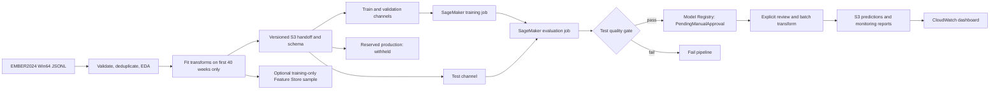
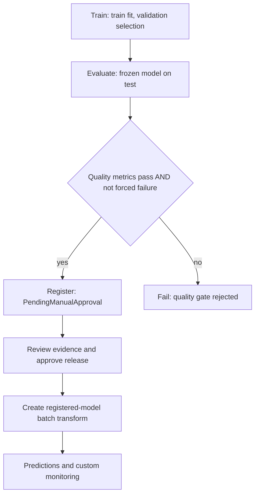

# Adaptive Static Malware Detection: ML System Design

AAI-540 Final Team Project, Group 1. Implementation branch: [`marco-model-training-evaluation`](https://github.com/dodo0-0/AAI-540-Final-Team-Project-Group1/tree/marco-model-training-evaluation).

This document describes the repository implementation and the operational evidence the team must collect in its own AWS account. Code and a portable notebook are provided; a passing local check does not establish that AWS resources were created, the real dataset was trained, or release criteria were achieved. Actual account results belong in the generated reports and final demonstration. Run instructions are in [the SageMaker runbook](sagemaker_runbook.md), and submission gaps are tracked in [rubric coverage](rubric_coverage.md).

## Problem statement

Security teams need to distinguish malicious Windows executables from benign software as attackers and software distributions change over time. Signature matching alone cannot cover previously unseen files, while a detector that flags too much benign software increases investigation effort and can interrupt legitimate work. This project frames that need as binary supervised classification of the static features of 64-bit Windows Portable Executable files: `label=1` means malicious and `label=0` means benign. The output is a maliciousness score plus a decision at a saved operating threshold, intended to support analyst triage.

The experiment uses the Win64 portion of EMBER2024 and a chronological evaluation protocol to test generalization to newer submissions. The local source is a Kaggle derivative with duplicate SHA-256 records; the pipeline removes duplicates and preserves weekly lineage. The initial model deliberately uses 13 reproducible numeric static aggregates rather than executable contents, antivirus results, family labels, or analysis-time metadata. This is a constrained baseline for one file type and period, not evidence of detection coverage for every malware family or a substitute for a layered security program.

## Goals and impact measurement

The principal goal is to catch as much malicious activity as possible while keeping the observed benign false positive rate at or below a configured operating budget, initially 1%. Candidate algorithms and their thresholds are selected using validation data only. The test report then measures recall, false positive rate, precision, F1, ROC-AUC, average precision, and confusion counts at the frozen threshold. A precision-recall plot, ROC plot, and weekly performance views in the notebook make the operating tradeoff visible. An empirical 1% validation limit is an experiment setting, not a statistical guarantee or a measured result; the team must report class counts and test behavior alongside it.

Operational impact is measured through successful reproducible pipeline runs, traceable model versions, valid batch outputs, drift reports, and the time and cost of each AWS run. False positive counts translate directly into potential analyst workload, while false negatives represent missed malicious samples; deployment decisions should account for the real incoming benign/malicious mix rather than benchmark accuracy alone. Acceptance requires a test report that meets the configured registration gates and a human review of limitations. No numeric model result, AWS runtime, cost saving, or business improvement is claimed until observed and recorded. The newest six-week reserve remains untouched for a later separately authorized evaluation.

## Architecture and data boundaries

The diagram describes the orchestration after prepared data is available. Raw-data validation and feature preparation remain explicit upstream stages; the training DAG does not silently rerun the 31.24 GiB raw-data scan. Feature Store demonstrates an additional managed feature publication path; the current training inputs remain versioned S3 CSV channels.

## Solution overview

### Data Sources

The repository's source is the Win64-only EMBER2024 download described in [dataset inventory](dataset_inventory.md). It contains 52 weekly official training shards and 12 weekly official test shards, spanning September 24, 2023 through December 14, 2024. Records contain static byte/string and PE structure features, hashes, submission metadata, and binary and taxonomy labels. Only static numeric aggregates enter this classifier. Neither the other EMBER2024 file types nor the challenge partition is present, so conclusions are limited to this Win64 experiment. The authoritative dataset description is the [EMBER2024 repository](https://github.com/FutureComputing4AI/EMBER2024).

The local copy showed doubled rows relative to the expected per-week source counts. `src/malware_data/validation.py` and the feature pipeline audit or remove repeated SHA-256 identifiers; source row counts must therefore be distinguished from unique sample counts. The project keeps source files local or in an optional immutable S3 raw prefix and shares prepared data through S3. Git contains code, configurations, notebooks, and documentation, with large data and generated outputs ignored. The actual bucket, account, region, source version, schema fingerprint, and split manifest must accompany each teammate's run.

### Data Engineering

The local pipeline is split into reusable modules under `src/malware_data` and CLI entry points under `scripts`. Streaming validation checks JSON validity, labels, types, missingness, weekly coverage, balance, and duplicates without loading every JSON object at once. EDA samples and reports provide distribution and leakage review before the compact feature contract is fixed. Feature preparation deduplicates source records, removes official-test records seen in the official training period, and writes deterministic ordered CSV columns plus a machine-readable schema and processing report.

`src/malware_data/splits.py` assigns rows by source week into 40 train, 12 validation, six test, and six reserved-production weeks. It rejects duplicate record identifiers across prepared inputs and records split counts, source windows, and the SHA-256 fingerprint of the exact feature schema. The distinction between the supplied official training partition and the 40-week model fitting set is essential: the last 12 official-training weeks are validation data and may not contribute even normalization statistics. Existing artifacts created before that correction must be regenerated by the data owner and published under a fresh S3 prefix. The strict trainer checks the preprocessing fit declaration before accepting a handoff.

### Feature Engineering

`src/malware_data/feature_prep.py` defines 13 numeric features covering file size and entropy, string statistics, PE section/import/export counts, Rich-header and parser-warning counts, and Authenticode certificate/self-signed information. Count-like fields receive `log1p`, approved values are standardized, and missing values map to the fitted mean in standardized space (`0.0`). The schema preserves source paths, base transforms, train means and standard deviations, missing counts, exclusions, and feature order. Normalization is fitted only on unique valid records whose source week starts on or before June 23, 2024, including the June 23–29 week.

Hashes, target and taxonomy fields, antivirus detection ratios, analysis timestamps, and source-week metadata are excluded from `X`. This prevents direct label leakage, memorization through identity, and future analysis information entering inference. Dynamic imports, strings, larger vectors, and Capa enrichments are deferred until extraction and training-serving parity can be demonstrated. Optional SageMaker Feature Store publication uses a bounded sample of model-training rows with record identifiers and event time, online and offline stores, and the same schema order. It validates managed feature-group operation without treating Feature Store as the training source for this version; AWS documents the two storage modes in [Feature Store storage configurations](https://docs.aws.amazon.com/sagemaker/latest/dg/feature-store-storage-configurations.html).

### Model Training & Evaluation

The training implementation under `sagemaker_src` compares fixed logistic regression, random forest, and histogram gradient boosting candidates. Each estimator fits only the chronological train split, with fixed random seeds where supported. The training entry point defaults to a deterministic class-stratified cap of 250,000 model-training rows to bound CPU cost; its report records available and used rows, and `--max-train-rows 0` removes that cap. This sampling stays inside the training period and does not change the chronological holdouts. Validation probabilities determine the threshold and candidate choice by maximizing recall within the configured maximum false positive rate. The selected estimator is not refitted using validation rows, and the test set is unavailable to candidate fitting and selection. Richer features or tuning require a fresh experimental plan that preserves these boundaries.

Training emits a model bundle containing the estimator, frozen threshold, and ordered input features, together with `feature_schema.json`, `training_report.json`, and training-reference histograms. A separate evaluation step loads that bundle and reports test metrics and weekly behavior. The quality gate uses the report to admit a version to Model Registry or fail the run; it is a release check, not permission to tune against repeated test outcomes. Results are described as an **official-test-derived temporal test subset**, because the official test partition is divided between test and reserve. The notebook displays generated comparisons and plots when artifacts exist and labels missing account evidence explicitly.

### Model Deployment

`src/malware_mlops` constructs a SageMaker pipeline that trains, evaluates, applies a condition, and registers passing models with `PendingManualApproval`. The passing path repackages inference source into the model archive before registration, so serving can load its code with network isolation enabled. Registration connects the versioned model artifact to its evaluation report and account-local package group. A successful pipeline establishes the configured checks passed in that execution; a registry reviewer still needs to review source provenance, test statistics, operating threshold, and limitations. SageMaker supports a DAG with conditional registration as described in [Define a pipeline](https://docs.aws.amazon.com/sagemaker/latest/dg/define-pipeline.html). This repository uses the pinned SDK v2 API, so examples from newer SDK generations should not be copied into it unchanged.

Batch transform is the default demonstration deployment path and uses a registered model package rather than an untracked local estimator. Input payloads contain only ordered, prepared numeric features; raw JSONL is not accepted by this serving contract. The serving functions validate the payload and apply the saved threshold to produce maliciousness scores and binary decisions. Manual approval is required before a production deployment; an explicitly identified demonstration may exercise a pending package where the account permits it. No persistent endpoint is created by default, reducing idle resource cost. A real-time endpoint, access service, rollback automation, and business-specific review process are future extensions rather than claims of this baseline.

### Model Monitoring

`sagemaker_src/monitor.py` compares observed feature histograms against model-fitting-sample reference histograms using population stability index (PSI), and reports missing normalized inputs and fractions outside the reference range. Raw missingness cannot be reconstructed after feature preparation has imputed those values. PSI is a descriptive alert heuristic, not a statistical significance test. These are custom monitoring reports; this implementation does not claim a scheduled SageMaker Model Monitor endpoint integration. Unlabeled drift is evidence of a distribution shift to investigate, not a measure of model accuracy. When delayed binary labels are available, the monitoring code computes classification metrics at the existing threshold. Test data can demonstrate the workflow, but it must be described as an evaluation demonstration rather than live production traffic.

The AWS helpers publish configured custom monitoring metrics and create a CloudWatch dashboard, with service/job metrics and links to run artifacts providing infrastructure evidence. [SageMaker monitoring in CloudWatch](https://docs.aws.amazon.com/sagemaker/latest/dg/monitoring-cloudwatch.html) explains the managed metrics available to the account. Capture actual run identifiers, dashboard panels with timestamps, the monitoring JSON, and any delivery failures for the demonstration. In production, a drift or delayed-label breach should open a review, investigate ingestion/extractor changes, and consider a new temporally isolated experiment; it should not automatically promote a retrained model. Scheduled collection, alarms, retraining triggers, and reserve evaluation remain operational extensions.

### CI/CD

`.github/workflows/ci.yml` runs repository checks and meaningful small synthetic tests of temporal boundaries, training/evaluation separation, feature-order validation, inference, and report contracts. Synthetic results establish that code paths behave as intended and cannot be quoted as real EMBER2024 performance. Notebooks are stored in `.ipynb` form with reusable Python logic outside cells. The separate optional AWS workflow uses GitHub OIDC with repository/environment settings and a scoped AWS role; it should not require storing permanent AWS access keys in GitHub. Account administrators must configure the role trust and permissions before enabling it.

The notebook or CLI builds the SageMaker DAG and can submit actual jobs after explicit cloud execution is enabled. A normal execution demonstrates the success branch when genuine test metrics satisfy the configured gates. A separate run can set the supplied forced-failure parameter to exercise the `Fail` branch; its logs and DAG must be labeled as a deliberate control-path test. Neither a graph drawn locally nor a mocked unit test replaces these two account executions. Production CD also requires manual package approval, environment authorization, and resource/cost review. Commit history and pull requests should reflect each member's real contributions; the implementation does not fabricate teamwork evidence.

Dependency/container compatibility is also a release concern. The branch pins scikit-learn 1.4.2 locally and uses the explicit regional AWS `1.4-2-py312` job image with SDK v2. As checked October 15, 2026, AWS lists this image's patch support ending October 30, 2026 in [its container support policy](https://docs.aws.amazon.com/en_en/sagemaker/latest/dg/pre-built-containers-support-policy.html). Before later operational use, choose a currently supported compatible image and rerun training, evaluation and serving checks. A local SDK serialization check does not verify that the chosen region has pulled or executed that container.

## Pipeline states for demonstration

The production-reserve file is omitted from training, evaluation, Feature Store sampling, and the default S3 download. A deliberate failed run should reuse the same split and declared configuration, with only the documented demonstration parameter changed.

## Security checklist

Status meanings: **Implemented** describes code present in this branch; **Configure/verify** requires an account owner to inspect or set AWS controls; **Operational** requires team action or evidence. This table does not certify an account's security posture.

| Control | Status and evidence | Remaining action |
|---|---|---|
| Secrets outside source control | Implemented: account values are supplied through ignored local config/environment and AWS credential providers. | Verify notebook outputs and commits contain no session tokens, signed URLs, or private keys. Use temporary credentials; rotate any exposed credential. |
| Individual, scoped access | Configure/verify: SageMaker takes an explicit execution-role ARN; CI cloud access is optional OIDC. | Scope S3 prefixes, SageMaker, Feature Store, CloudWatch, and `iam:PassRole`; restrict OIDC trust to the repository/ref or protected environment. Learner Lab may supply an existing role. |
| S3 public access and encryption | Configure/verify: code does not make buckets public; account-specific bucket and optional encryption settings are required. | Inspect Block Public Access, bucket policy, default encryption, and permitted principals. A configured KMS key also needs usable key permissions. |
| Transport encryption | Implemented through AWS SDK HTTPS APIs; configure/verify storage policies. | Enforce TLS in bucket policy where permitted; do not publish credential-bearing URLs. |
| Network isolation and private connectivity | Configure/verify; private VPC routing is not provisioned by this educational notebook. | Select approved subnets/security groups and VPC endpoints if required; review permitted internet egress and container dependencies. |
| Auditing and infrastructure evidence | Implemented dashboard/report helpers; Operational account evidence remains required. | Check CloudTrail coverage, job logs, dashboard timestamps, and retention policies. Logs must not contain raw sensitive samples or secrets. |
| Artifact integrity and lineage | Implemented schema fingerprint, split metadata, saved threshold, and registry versions. | Retain exact source commit, object versions/checksums, role, region, and execution IDs. Load trusted `joblib` artifacts only because deserialization can execute code. |
| Data minimization and access segregation | Implemented 13-feature contract and default reserve exclusion. | Keep raw records and reserve prefix access restricted; inspect records before broader sharing and verify dataset license/attribution requirements. |
| Approval and rollback | Implemented pending registration and explicit batch deployment path. | Assign a reviewer, approve a specific package for production, retain a known-good package, and document how to stop/revert a release. |
| Retention and cost cleanup | Operational runbook; no automatic deletion of shared data. | Stop notebook apps, remove disposable feature groups/models/dashboard resources as appropriate, and set reviewed S3/CloudWatch lifecycle policies. |

AWS describes account-owner obligations and data controls in [Data protection](https://docs.aws.amazon.com/sagemaker/latest/dg/data-protection.html) and [encryption at rest](https://docs.aws.amazon.com/sagemaker/latest/dg/encryption-at-rest.html). Optional encryption configuration is not proof that any particular job or bucket used a required key.

## Bias, sensitive data, and ethical risks

This dataset is a sample of collected files, not the population of all benign software and malware. VirusTotal-derived labels and collection timing can favor frequently submitted or well-detected families; missing or delayed labels can make apparent accuracy misleading. Win64-only scope and compact aggregate features can underperform on rare packers, small software publishers, self-signed software, novel evasive malware, or shifts in signing practices. Weekly comparisons and signing-related feature review can expose some limitations, but this version has no validated demographic fairness claim and no complete family-level audit. Family labels are excluded from model input and would require a separately controlled join for subgroup evaluation.

File hashes and metadata can disclose possession or provenance of a particular file even when executable binaries are absent. Limit sharing to authorized participants, avoid placing identifiers into public logs/screenshots, and do not assume a public research dataset contains no sensitive information. The project does not execute malware; static extracted records are sufficient for the workflow. Scores should support a human review or defense-in-depth process, since automatic quarantine based on an uncalibrated score could harm legitimate users. Record adverse outcomes, investigate drift and false positives, and validate against a current approved holdout before considering a new deployment. The reserved period must not become an informal tuning set after the main test is inspected.

## Validation record and final submission

Populate the final design with the source commit, data/S3 versions, SageMaker execution ARNs, actual validation and test metrics, model package ARN and approval state, transform output URI, monitoring-report URI, and CloudWatch dashboard name after a real run. Capture both successful and explicitly forced-failed pipeline executions. The portable implementation is the starting point for this evidence, not a substitute for it.

Export the reviewed design as `Final-Project_Team-1_Deliverable-1.pdf`, record `Final-Project_Team-1_Deliverable-2.mp4`, and provide the [demo outline](demo_outline.md) plus the branch/repository link for Deliverable 3. The assignment text requests 10–15 minutes while its highest video rating says no more than 10 minutes; target 10 minutes and verify the instructor's intended boundary. The team must choose a submission delegate, submit required files together, and complete individual peer evaluations separately.
