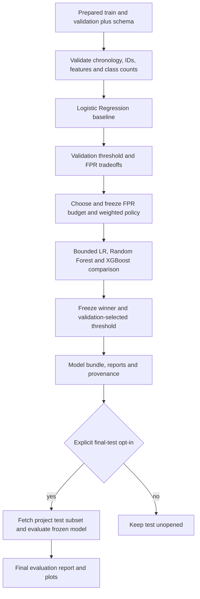

# Adaptive Static Malware Detection: Modeling Design

AAI-540 Group 1 — Gaurav SS, Marco Gonzalez Ortiz, and Nitendra Tiwari.

This branch implements the ML modeling workstream: a baseline, bounded model comparison, validation-based policy and threshold selection, and separately enabled final evaluation. It consumes the existing prepared-data contract and produces reproducible model artifacts for teammates. [Scope and source alignment](modeling_scope.md) distinguishes this work from the broader project roadmap in the RFC and teamwork tracker. Account instructions are in [the modeling runbook](sagemaker_runbook.md).

## Problem and intended impact

A hypothetical managed security service provider must prioritize suspicious Windows files without executing them. Signature-based controls can miss new or modified malware, while excessive benign false alerts consume analyst time. The project treats this as supervised binary classification using static Win64 EMBER2024 features: `0` is benign and `1` is malicious. The model returns a maliciousness score and a thresholded decision to support human investigation. A score is not a guarantee that a file is safe or malicious.

The modeling objective is to compare an interpretable baseline against nonlinear ensembles while balancing malicious recall, benign false-positive rate (FPR), classification quality, and computational cost. Report actual false-positive and false-negative counts with their denominators, since a benchmark rate is not a guarantee under a different class mix. Estimate review volume only under explicitly stated traffic/prevalence assumptions; do not invent savings, endpoint performance, or successful AWS executions. Temporal performance on later collected files supports a limited newer-time evaluation, not a universal claim about future threats.

## Data and feature contract

The upstream dataset is the Win64 portion of EMBER2024. Its local Kaggle derivative contains duplicate SHA-256 records; the existing streaming data pipeline deduplicates records and preserves source-week lineage. [Dataset inventory](dataset_inventory.md) describes the source and provenance limits. The RFC requires at least 10,000 labeled examples per predicted class. The handoff validator reports actual class counts and enforces `data.minimum_class_rows`, initially 10,000 per class in the full model-training CSV before any optional model-fitting cap. Validation must contain both classes. This scope excludes raw, duplicate, and rejected records; synthetic fixtures and a reduced test setting do not establish the real dataset requirement. No real counts or model results are asserted here without the corresponding generated artifacts.

The model consumes the 13 ordered numeric columns in `feature_schema.json` → `model_feature_columns`: file/string statistics, PE structure counts, parser-warning counts, and signing aggregates. Count-like fields use `log1p`, then approved features are standardized with fitted training statistics; missing values map to the fitted mean in standardized space. Hashes, labels, taxonomy, antivirus metadata, timestamps, and other lineage fields are excluded from `X`. The schema and ordered payload contract travel with the model. The models share this fixed feature representation so their comparison changes the learning algorithm rather than silently changing the available information.

The preprocessing cutoff is the inclusive source-week start `2024-06-23`, covering the last model-training week June 23–29. A strict schema declares `fit_scope: "model_train_only"`; validation weeks contribute no fitted means or variances. Older handoffs fitted on all 52 official-training weeks must be regenerated, not relabeled. An explicit legacy override is exploratory only and must appear in the report. Details remain in [feature preparation](feature_preparation.md).

| Split | Weekly coverage | Modeling use |
|---|---|---|
| Train | 40 weeks, 2023-09-24 through 2024-06-29 | Fit preprocessing and estimators; bounded search remains inside this period. |
| Validation | 12 weeks, 2024-06-30 through 2024-09-21 | Baseline tradeoffs, policy, hyperparameter/candidate comparison, threshold choice. |
| Test | First six official-test weeks, 2024-09-22 through 2024-11-02 | Final metrics after the winner, threshold, and policy are frozen. |
| Reserved production | Newest six official-test weeks, 2024-11-03 through 2024-12-14 | Untouched by this workflow. |

The current README and the tracker's concrete Module 4 decision take precedence over the RFC's earlier full-official-test wording. Results must be described as an **official-test-derived temporal subset**. There is no random train/test reshuffle. Default downloads, training inputs, validation checks, and comparison jobs exclude test records until final evaluation is requested; reserve records are never downloaded or opened by the modeling workflow.

## Modeling workflow

`sagemaker_src/training.py` contains reusable fitting, threshold, scoring, and evaluation logic; the notebook explains decisions and renders its measured outputs. A standalone Logistic Regression baseline first characterizes the dataset and validation tradeoffs. Comparison then uses Logistic Regression, Random Forest, and XGBoost 3.0.5, with a small predefined set of two trials per family. Models fit only training rows; validation selects trial, family, and threshold. The default model-fitting cap is a deterministic stratified sample of 250,000 training rows; `compute.max_train_rows: 0` removes it. Seeds, exact parameters, and available/used counts are recorded, and baseline/comparison must use matching data hashes, seed and cap. The chosen model is not refitted on validation before test evaluation.

XGBoost is the selected RFC alternative because it supplies a familiar boosted-tree comparison; LightGBM is not additionally added. The Python code uses CPU XGBoost rather than claiming an AWS built-in XGBoost training algorithm. Dependencies pin the tested version, with the CPU package used where supported; see [the XGBoost installation guide](https://xgboost.readthedocs.io/en/release_3.0.0/install.html). Logistic Regression supplies a simpler interpretable benchmark, Random Forest captures nonlinear interactions through bagging, and XGBoost supplies a distinct boosting approach. This is a bounded comparison, not an exhaustive search for a globally optimal detector.

## Baseline-dependent policy and weighted selection

The RFC leaves the acceptable FPR and model-selection weights open. The implementation therefore starts with an unapproved policy and no FPR budget. Review the baseline validation threshold table/curves before choosing the budget. The notebook requires an explicit choice and rationale, then writes the policy with `approved: true`, the baseline report SHA-256, and an approval timestamp no earlier than the baseline report. The comparison checks that linkage. A proposed default or example file is not evidence of a previously approved team decision.

The proposed Option A policy below is configurable and must be frozen before comparison and final test. It weights recall, FPR, PR-AUC, F1, local inference latency, serialized model size, and an explicit interpretability prior. Precision, ROC-AUC, accuracy, confusion counts, and qualitative deployment complexity are still reported even though they do not receive weights in this option. This distinction resolves the RFC's broader criteria list without silently pretending every criterion appears in the proposed seven-weight formula.

| Weighted criterion | Proposed weight | Interpretation |
|---|---:|---|
| Malware recall | 0.30 | Higher detects more malicious samples. |
| Benign FPR | 0.25 | Lower reduces false alerts; the chosen FPR budget is also an eligibility constraint. |
| PR-AUC | 0.15 | Higher improves the ranking assessment under class imbalance. |
| F1 | 0.10 | Higher balances precision and recall at the selected threshold. |
| Local inference latency | 0.10 | Lower is preferred; proposed reference is 20 ms. |
| Serialized bundle size | 0.05 | Lower is preferred; proposed reference is 20 MiB. |
| Interpretability | 0.05 | Explicit subjective priors: LR 1.0, RF 0.5, XGBoost 0.3. |

Only validation probabilities are used to choose operating thresholds, including complete tied-score groups rather than arbitrarily separating equal scores. The comparison report records raw criteria, normalized score components, weights, constraints, and the winning trial. PR-AUC uses the average-precision definition. Recall, PR-AUC and F1 enter the score directly; the FPR component is `1 - FPR / budget` for an eligible positive budget, or `1` when both budget and FPR are zero. Latency and size components are `1 / (1 + measurement / reference)`, with size measured in MiB. Candidates outside the FPR budget are ineligible, and ties use recall, FPR, then trial ID. Reference values and subjective priors remain visible decision assumptions, not measured fairness or explainability results.

Latency uses up to 32 seeded validation rows, up to three warmup calls, and one timed single-record `predict_proba` call per selected row, reporting local p50/p95. It excludes endpoint networking, serialization, cold starts, and service overhead. Host load can alter timing and therefore a latency-weighted ranking even with a fixed seed. Model size is the measured compressed `joblib` bundle, excluding schema/report/source archive overhead, rather than an estimate based on model family. Preserve this measurement scope when comparing environments.

## Final evaluation and artifacts

Final test is a separate opt-in after selection is fixed. It loads the saved winner and threshold, verifies the feature/schema contract, and computes recall, FPR, precision, F1, ROC-AUC, PR-AUC, accuracy, confusion counts, and weekly metrics. Curves and confusion plots in the notebook use actual resulting predictions. The test report must not trigger threshold adjustment, another candidate search, a changed weighted policy, or reserve access. If limitations emerge, preserve the result and plan a separate temporally valid experiment.

The modeling handoff contains `model.joblib`, `feature_schema.json`, `baseline_report.json`, `training_report.json`, `selection_policy.json`, and optional `evaluation.json`, with parameters, the selection decision, environment/package versions, source revision and file hashes, seed, and data/schema fingerprints. Retain S3 artifact URIs and actual SageMaker job names for managed runs. Loading `joblib`/pickle can execute code: consume only artifacts produced by the team's trusted workflow. Generated data, models, account settings, and large reports stay outside Git; code and portable notebooks remain versioned.

## SageMaker execution boundary

The account helper supports a managed baseline training job and a separate managed comparison job. Final evaluation runs against the trusted frozen model in the notebook kernel after explicit opt-in; it creates no processing or deployment job. Each member supplies an existing bucket and allowed execution role in their own account; the notebook can also use the same training entry points locally for debugging. Runtime installation of the pinned XGBoost dependency requires permitted package-index network access. This branch does not provision IAM, buckets, Terraform, endpoints, a registry, Feature Store, dashboards, monitoring schedules, or CI/CD deployment workflows. Those RFC roadmap components belong to separate workstreams.

AWS execution is disabled until explicitly enabled. The current job container uses the documented regional Python 3.12 scikit-learn image; its SDK selector and image tag are separate configuration fields. As checked October 15, 2026, the `1.4-2-py312` image's patch support ends October 30, 2026 under [AWS's container support policy](https://docs.aws.amazon.com/en_en/sagemaker/latest/dg/pre-built-containers-support-policy.html). Review a supported replacement before later use and validate dependency, model serialization, and prediction compatibility. No real dataset training, cloud success, or operational performance is inferred from offline tests.

## Risks and validation limits

Win64-only collection, dated labels, duplicate-source provenance, signing practices, class prevalence, packers, and attacker adaptation can change generalization. Compact features may omit useful signal and can encode collection or publisher biases. The workflow excludes obvious leakage sources, preserves chronology, and makes false-alert tradeoffs explicit, but it does not establish adversarial robustness, family coverage, subgroup fairness, or suitability for automatic blocking. Treat scores as decision support and report benign/malicious denominators and temporal scope.

Keep credentials in the AWS provider chain, use scoped access and private encrypted S3 storage, and avoid exposing file identifiers in shared outputs. Local tests should verify candidate families, temporal/data isolation, policy linkage, threshold ties, weighted-score behavior, saved-schema compatibility, and final-test/reserve boundaries. Synthetic results validate mechanics only; the actual dataset class minimum, measured model comparison, final test behavior, package installation, and account permissions require corresponding real execution evidence.
